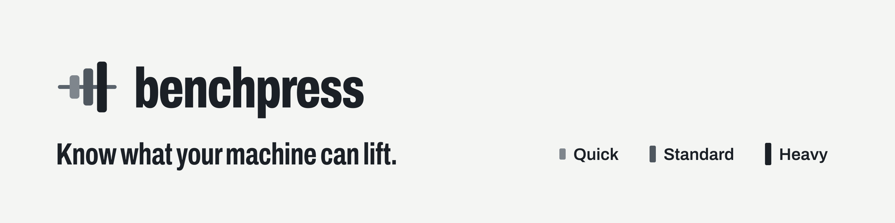

<picture>
  <source media="(prefers-color-scheme: dark)" srcset="docs/assets/banner-dark.png">
  
</picture>

Know what your machine can lift. Benchpress builds real Rust projects with a pinned toolchain, times each build, and shows how your machine compares with others on [benchpress.dev](https://benchpress.dev).

```sh
curl -fsSL https://benchpress.dev/install.sh | sh
benchpress run quick
```

Linux (x86_64 and arm64) and Apple Silicon Macs. The installer puts one static binary in `~/.local/bin` and verifies its SHA-256 checksum. It never uses `sudo`.

<!-- TODO: screenshot of a result page -->

## Suites

| Tier | Project | Typical time | Disk |
| --- | --- | --- | --- |
| `quick` | ripgrep 16.0.0 | 1 to 4 minutes | 2 GB |
| `standard` | rust-analyzer 2026-11-16 | 8 to 30 minutes | 8 GB |
| `heavy` | nushell 0.117.0 | 20 to 90 minutes | 14 GB |

Each suite runs five scenarios three times: a clean debug build, a clean release build, `cargo check`, and two incremental rebuilds after editing a leaf crate and a core crate. The report shows the median of each.

## Commands

```
benchpress                  pick a suite interactively
benchpress run <suite>      run quick, standard or heavy
benchpress list             list suites
benchpress results          list local results; `results show <id>` for one
benchpress submit <id>      review the payload, then publish it
benchpress unpublish <id>   delete a published result
benchpress doctor           check the toolchain, disk space and power state
benchpress clean            delete cached sources and toolchains
```

Results stay on your machine until you run `submit` or confirm the prompt after a run. A published result has no username, hostname, IP address or file paths. See [docs/methodology.md](docs/methodology.md) for what is measured and how.

## Repository

- `crates/core`: result schema, suite manifests, hashing and validation, shared by the CLI and server.
- `crates/cli`: the `benchpress` binary.
- `crates/server`: the website and API, one binary with one SQLite file.
- `suites/`: suite manifests and `suites.lock`.
- `deploy/`: systemd unit, Caddyfile and Litestream config. See [docs/deploy.md](docs/deploy.md).

Read [CONTRIBUTING.md](CONTRIBUTING.md) before opening a pull request.

## License

MIT or Apache-2.0, at your option.
